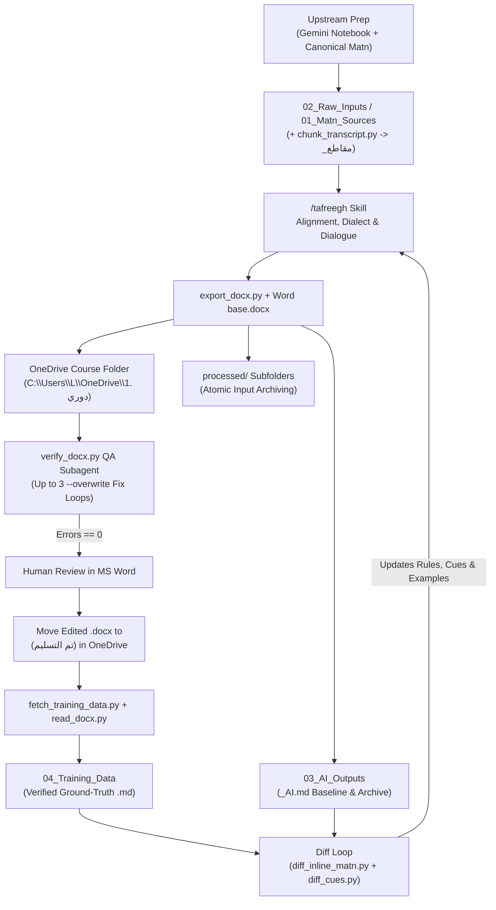

# Tafreegh Project Overview (مشروع تفريغ وتحقيق الدروس الشرعية)

> [!abstract] Summary
> **Tafreegh** (`تفريغ الدروس الشرعية`) is the scholarly transcription, canonical-text alignment, Microsoft Word publishing, and continuous-learning pipeline for **The Curriculum** (`الدوري`), delivered by **Sheikh Osama** (`فضيلة الشيخ أسامة`). It transforms raw **Gemini Notebook** drafts into Word-ready `.docx` deliverables aligned verbatim with classical Islamic texts (_Matn_) under **Blind Literalism**, validates output via a post-export QA subagent, and improves from human Word edits via the **Diff Loop**.

> [!tip] Interactive Visual Architecture
> ![[Tafreegh-Overview.canvas]]
>
> _Obsidian Vault Note_: `tafreegh-skill/` at the repository root is a non-dot Windows junction to `.agents/skills/tafreegh/`, allowing Obsidian to resolve and preview `SKILL.md` and `references/*.md` directly while `.agents/` remains ignored as a dot-directory.

---

## 1. End-to-End Pipeline

---

## 2. 4-Folder Data Architecture

Defined in [[CONTEXT]] and enforced by `scripts/verify_repo.py`:

| Folder             | Role                                                                                      | Archiving & Lifecycle                                                      | Key Subfolders                    |
| :----------------- | :---------------------------------------------------------------------------------------- | :------------------------------------------------------------------------- | :-------------------------------- |
| `01_Matn_Sources`  | Per-lecture canonical vowelized Markdown texts (**Matn Source**) for **Blind Literalism** | Consumed sources archive atomically on verified export                     | `processed/`                      |
| `02_Raw_Inputs`    | Unedited raw speech drafts extracted from **Gemini Notebook**                             | Long files split temporarily via `chunk_transcript.py`; archived on export | `processed/`, temporary `_مقاطع/` |
| `03_AI_Outputs`    | Flat internal archive of `_AI.md` baselines and `.docx` exports for the **Diff Loop**     | Permanent baseline archive (never moved to `processed/`)                   | —                                 |
| `04_Training_Data` | Human-reviewed ground-truth `.md` transcripts extracted from OneDrive `(تم التسليم)`      | Populated by `fetch_training_data.py` + `read_docx.py`                     | —                                 |

> [!info] OneDrive Delivery & Workspace Junctions
>
> - Exported `.docx` deliverables route automatically to `C:\Users\L\OneDrive\1. دوري\<Course>`.
> - `.agents/skills` is a directory junction to `C:\Users\L\.agents\skills` (containing shared global skills such as `arabic-word-production` outside Tafreegh's runtime).
> - `tafreegh-skill/` (`.gitignore`d) is a root non-dot junction pointing to `.agents/skills/tafreegh/` for clean Obsidian file resolution.

---

## 3. Core Transcription & Alignment Architecture

Operational rules live in [[tafreegh-skill/SKILL|SKILL]], with domain vocabulary defined in [[GLOSSARY]].

### Matching Modes (`matn_matcher.py`)

| Mode                              | Condition                                                                 | Behavior                                                                                                                                                                                                                                                      |
| :-------------------------------- | :------------------------------------------------------------------------ | :------------------------------------------------------------------------------------------------------------------------------------------------------------------------------------------------------------------------------------------------------------ |
| **Primary Mode**                  | **Matn Source** provided and passage matches                              | Tracks reading position with a **Sequential Cursor** (`2,000`-char forward window + `0 -> cursor` look-behind for re-reads). Replaces spoken words character-for-character with full _tashkeel_.                                                              |
| **Dynamic Fallback Interleaving** | **Matn Source** provided, but speaker reads passages absent from the file | Switches per segment between **Primary Mode** and **Fallback Mode**, annotating unvowelized fallback blocks with `<!-- fallback -->` and applying **Sandwiched Context** (**Conservative Doubt**), **Compound Sharh-Matn**, and **Seam Repetition** handling. |
| **Fallback Mode**                 | No **Matn Source** available                                              | Detects book readings via verbal transition cues (`قال`, `يقول`, `روى`, `قال المصنف`, etc.) and 100% Classical Arabic fingerprint; transcribes in plain orthography.                                                                                          |

### Linguistic & Formatting Rules

- **Blind Literalism**: Verbatim one-to-one speech transcription preserving Egyptian colloquialisms, repetitions, affirmative fillers, and audio cues (`ههههه`) with zero summarizing or polishing.
- **Matn vs. Explanation Separation**: Standalone Matn blocks sit on their own bold line `**(نص المتن المشكول)**` with single newlines; repeated clauses inside commentary stay inline `(الكلمة)` unless **Anchor Expiry** (`>= 500` words / `~2,500` chars) or new unbolded words trigger a new standalone block.
- **Active Dialogue & Student Attribution**:
  - Sheikh's speech carries no speaker prefix.
  - Audible student turns sit on their own regular-weight paragraph prefixed with `طالب: `.
  - Inaudible turns (`طالب: صوت غير مسموع.`) insert proactively after thought-ending matches in the `13`-item **Known Cue** list, while **Rhetorical Suffixes** (`ها؟`, `إيه؟`) are suppressed from cue nomination.
  - **Attendee Anonymization**: Live attendee names become `فلان` across all grammatical positions while preserving classical placeholders and historical names.
- **Egyptian Dialect, Word Styling & Benchmarks**: Standardized in [[tafreegh-skill/references/dialect-rules|dialect-rules]] and [[tafreegh-skill/references/formatting-rules|formatting-rules]], compiled onto `Word base.docx` (`0.5"` margins, `Traditional Arabic` `18pt`, RTL `w:bidi`/`w:rtl`), and anchored by `8` golden examples in `tafreegh-skill/examples/` (`4` Primary + `4` Fallback).

---

## 4. Dynamic Course Routing Map (12 Canonical Courses)

Parsed dynamically at runtime from [[CONTEXT]] § 3 via `lecture_identity.py` (`LectureIdentity` supports both `YYYY-MM-DD` date stems and mirrored `[N]-[subject]_[N]` **Numbered Lecture Stems**):

| Routing Keywords                | Canonical Course Name         | Source Text                                |
| :------------------------------ | :---------------------------- | :----------------------------------------- |
| `زاد` / `زاد المعاد`            | **زاد المعاد**                | زاد المعاد في هدي خير العباد (ابن القيم)   |
| `صيد` / `صيد الخاطر`            | **صيد الخاطر**                | صيد الخاطر (ابن الجوزي)                    |
| `رياض` / `رياض الصالحين`        | **رياض الصالحين**             | رياض الصالحين (النووي)                     |
| `سيرة` / `الرحيق` / `رحيق`      | **سيرة (الرحيق المختوم)**     | الرحيق المختوم (المباركفوري)               |
| `ديوان` / `ديوان الشافعي`       | **ديوان الشافعي**             | ديوان الإمام الشافعي                       |
| `توحيد` / `فتح الباري` / `فتح`  | **فتح الباري (كتاب التوحيد)** | فتح الباري شرح صحيح البخاري - كتاب التوحيد |
| `روضة` / `مختصر الروضة`         | **شرح مختصر الروضة**          | شرح مختصر الروضة                           |
| `أصول` / `لب الأصول` / `لب`     | **لب الأصول**                 | لب الأصول                                  |
| `معاملات` / `دليل`              | **دليل الطالب (كتاب البيع)**  | دليل الطالب (كتاب البيع)                   |
| `بيوع` / `فقه_البيوع` / `خثلان` | **فقه البيوع (سعد الخثلان)**  | فقه البيوع (سعد الخثلان)                   |
| `أسماء`                         | **الأسماء الحسنى**            | الأسماء الحسنى                             |
| `منطق` / `سلم` / `السلم`        | **المنطق (السلم المنورق)**    | السلم المنورق في علم المنطق                |

---

## 5. Automation Scripts, QA & Governance

### Pipeline Scripts (`tafreegh-skill/scripts/` & `scripts/`)

| Script                   | Responsibility                                                                                                                                                 |
| :----------------------- | :------------------------------------------------------------------------------------------------------------------------------------------------------------- |
| `lecture_identity.py`    | `LectureIdentity` entity, dynamic routing parser from [[CONTEXT]], stem normalization, and cross-folder matching                                               |
| `matn_matcher.py`        | **Sequential Cursor**, forward/look-behind matching, dynamic fallback interleaving, and compound Sharh-Matn seam handling                                      |
| `chunk_transcript.py`    | Splits long transcripts into ~`1,300`-word chunks (`1,000`–`1,600`) along natural Arabic sentence boundaries (mirrored at `scripts/chunk_transcript.py`)       |
| `export_docx.py`         | Compiles Markdown into `Word base.docx` `.docx`, strips **Markdown Leakage**/summaries, archives `_AI.md`, moves inputs to `processed/`                        |
| `verify_docx.py`         | Post-export QA validator checking formatting, RTL XML, dialect compliance, attendee leaks, and Matn fidelity against raw/source inputs                         |
| `fetch_training_data.py` | Scans OneDrive `(تم التسليم)` for edited `.docx`, extracts Markdown via `read_docx.py`, saves to `04_Training_Data/`, runs cue/diff analysis                   |
| `read_docx.py`           | Reads `.docx` XML (`word/document.xml`), preserving bold Matn markers while normalizing extracted text                                                         |
| `diff_inline_matn.py`    | Classifies Matn diffs into `fallback_correction` (**Fallback Correction**), `oral_citation` (**Oral Citation**), `matn_copy_error`, and `anchor_expiry_reread` |
| `diff_cues.py`           | Proposes new **Known Cue** candidates from user-inserted `طالب: صوت غير مسموع.` lines while filtering **Rhetorical Suffixes**                                  |
| `scripts/verify_repo.py` | Repository guardrail validating folders, root whitelist, `.scratch/` containment, table syntax, positive steering phrasing, and ADR 0003 rules                 |

### Architecture Decision Records (`docs/adr/`)

- [[0001-review-guardrails]] — Automated review guardrails & root scope whitelisting (`scripts/verify_repo.py`)
- [[0002-atomic-archiving-and-hybrid-matn]] — Atomic input archiving (`processed/`) & **Dynamic Fallback Interleaving**
- [[0003-markdown-leakage-sanitization]] — Defense-in-depth sanitization against **Markdown Leakage**
- [[0004-numbered-lecture-routing-and-stem-matching]] — **Numbered Lecture Stem** routing (`[N]-[subject]_[N]`)
- [[0005-lecture-identity-and-dynamic-routing-ssot]] — `LectureIdentity` domain entity, dynamic [[CONTEXT]] routing SSOT, and single-gap Matn paragraphs
- [[0006-rhetorical-suffix-cue-suppression]] — Suppressing **Rhetorical Suffix** (`ها؟` / `إيه؟`) false-positive cue nominations
- [[0007-intra-citation-ayah-asterisks]] — Allowing spaced `*` inside multi-ayah Quranic citations `(آية * آية)`
- [[0008-compound-sharh-matn-alignment]] — Preserving continuous **Compound Sharh-Matn** blocks across commentator transitions

> [!note] Governance & Testing
>
> - Standards live in [[CODING_STANDARDS]], temporary scratch runs stay confined to `.scratch/`, and deferred review items are tracked in [[deferred-reviews]] (`D1`–`D7` resolved).
> - Pre-commit hooks use **Husky**, **lint-staged**, and **Prettier**, backed by `10` pytest test files across `tests/` (`1`) and `tafreegh-skill/tests/` (`9`).
